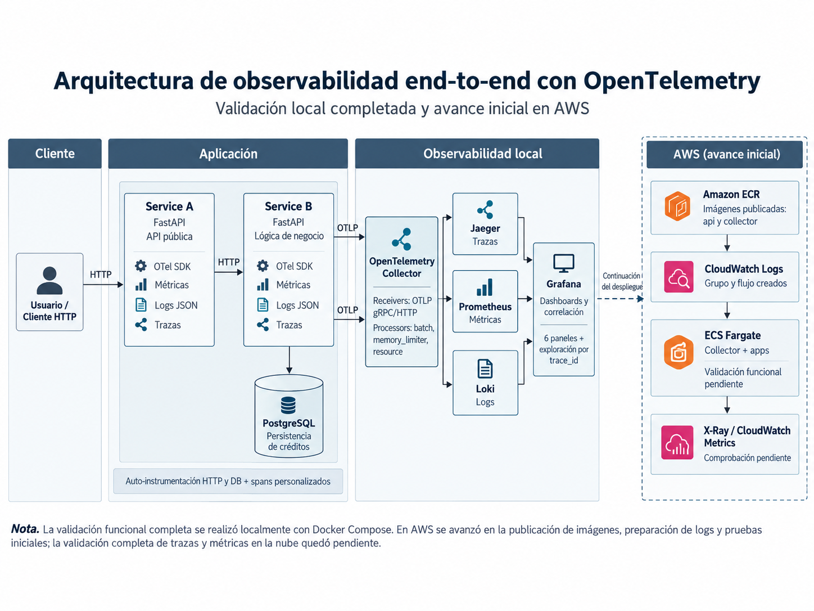

# Laboratorio de observabilidad end-to-end con OpenTelemetry: validación local y trabajo realizado en AWS

Danny Tatiana Morales Jiménez · Juan Daniel Valderrama Pérez · Camilo Mora Rodriguez

Materia: Observabilidad en ambientes productivos

Profesora: María Fernanda Ochoa Paipilla

Octubre de 2026

https://github.com/camilomora90/observability-end-to-end

## 1. Introducción

La observabilidad permite conocer el comportamiento de una aplicación e identificar dónde se presentan errores o retrasos. En este laboratorio implementamos OpenTelemetry sobre una API de solicitudes de crédito desarrollada en Python, utilizando dos microservicios y PostgreSQL.

Service A recibe las solicitudes HTTP y se comunica con Service B, encargado de realizar las operaciones sobre la base de datos. Ambos servicios fueron instrumentados para generar métricas, logs estructurados y trazas distribuidas.

OpenTelemetry Collector centraliza estas señales y las distribuye hacia Jaeger, Prometheus y Loki. Grafana facilita su consulta y visualización, mientras que k6 permite evaluar el impacto de la instrumentación sobre el rendimiento. La instrumentación de Python se apoya en las API y el SDK documentados por OpenTelemetry (s. f.).

El trabajo comprende una implementación local validada, una preparación inicial de recursos en AWS y una propuesta de infraestructura para Google Cloud. Diferenciamos estos alcances porque disponer de archivos o imágenes no demuestra que una aplicación esté funcionando en la nube. Para cada resultado usamos las evidencias guardadas en el repositorio y señalamos las comprobaciones que quedaron pendientes.

## 2. Arquitectura de observabilidad

La Figura 1 presenta la arquitectura local validada y el avance inicial en AWS. La cadena funcional es cliente → Service A → HTTP → Service B → PostgreSQL. El contexto de traza acompaña el salto entre los microservicios y permite relacionar la solicitud con la operación SQL. Este mecanismo sigue el estándar Trace Context de World Wide Web Consortium (2021).

**Figura 1**

*Arquitectura de observabilidad end-to-end con OpenTelemetry*

Nota. La validación funcional se realizó localmente con Docker Compose. En AWS se publicaron imágenes y se prepararon destinos de registros; ECS Fargate representa una etapa propuesta. La recepción de logs, métricas y trazas en AWS quedó sin confirmar.

Las flechas del bloque AWS representan etapas de preparación y continuación del trabajo, no un flujo de telemetría comprobado entre esos servicios. ECR almacena las imágenes publicadas y CloudWatch Logs dispone de un grupo y un flujo creados. El bloque ECS Fargate corresponde al despliegue propuesto: no hay evidencia suficiente de la aplicación ni del Collector funcionando allí. No se confirmó recepción de logs, métricas personalizadas ni trazas en AWS. GCP no aparece en la figura porque no se desplegó; su propuesta se describe en la sección 6.

En el entorno local, el Collector recibe OTLP, limita el consumo de memoria, agrupa los datos y los entrega a los destinos de cada señal: trazas a Jaeger, métricas a Prometheus y registros a Loki. Grafana consulta estos backends. Una traza reúne spans que describen operaciones y sus relaciones; este modelo permite seguir el recorrido de una solicitud (Jaeger, s. f.). La configuración local y la preparación AWS tienen destinos diferentes y no deben interpretarse como una única validación.

## 3. Implementación y validación local

### 3.1. Instrumentación y persistencia

Ejecutamos la solución mediante Docker Compose e incorporamos instrumentación automática de FastAPI, del cliente HTTP httpx y de SQLAlchemy para PostgreSQL, además de spans personalizados de operaciones de negocio. Service A conserva los endpoints públicos de créditos; Service B realiza la persistencia. El volumen de PostgreSQL permite conservar los datos al reiniciar el microservicio B.

Los registros de negocio incluyen trace_id y span_id para relacionar eventos de una misma solicitud. En las evidencias aparece la traza 868d7e4a569d404cb1dcfa718703ab90, con participación de service-a, service-b y una operación PostgreSQL. Los archivos trace.json y logs.json permiten revisar esa relación junto con las capturas originales de Jaeger y Grafana, sin depender únicamente de la descripción del informe.

### 3.2. Pruebas funcionales y de integración

Completamos diez pruebas automatizadas dentro de Docker y conservamos sus dos advertencias de deprecación en tests.txt. Las pruebas cubren el comportamiento de la API y la traducción de errores de comunicación. Este resultado corresponde al entorno registrado y no a una nueva ejecución realizada para redactar el informe.

También aprobamos trece comprobaciones de integración, enumeradas en validation.json: salud, creación, lectura, listado, actualización, respuestas 404 y 422, persistencia tras reiniciar Service B, traza común de A y B, span PostgreSQL, logs correlacionados en Loki mediante Grafana, objetivos activos de Prometheus y seis paneles provisionados. Comprobamos la persistencia consultando el crédito después del reinicio, además de verificar la existencia del volumen.

En una prueba de falla controlada interrumpimos Service B y verificamos que Service A respondiera HTTP 503 con el mensaje Credit storage unavailable. El archivo failure.json conserva la respuesta y su trace_id. La prueba verifica el comportamiento ante la indisponibilidad de esa dependencia; no mide recuperación automática, alta disponibilidad ni rendimiento durante una falla prolongada.

### 3.3. Consulta de las señales y límites de la validación

Prometheus registró cuatro objetivos de recolección activos: Service A, Service B, las métricas internas del Collector y su exportador de métricas OpenTelemetry. El estado up comprueba que el scrape fue atendido; para comprobar las operaciones de créditos usamos adicionalmente las pruebas funcionales. Las consultas del dashboard y las capturas muestran la disponibilidad de métricas para su análisis.

Jaeger permitió visualizar las operaciones de los dos microservicios y PostgreSQL. En Grafana se consultaron métricas y registros almacenados en Loki. La configuración efectiva y las consultas guardadas en correlation-runtime.json verifican la correlación entre logs y trazas con el mismo identificador. Grafana documenta esta consulta de trazas y sus integraciones (Grafana Labs, s. f.-b). No afirmamos que cada muestra de una métrica agregada tenga un trace_id ni que se haya automatizado la navegación visual de exemplars.

Además del benchmark, se conservaron escenarios cortos de k6. Errores y pico cumplieron sus umbrales; el escenario normal aprobó las comprobaciones funcionales, pero terminó con código 99 porque su p99 de 1.241,05 ms superó el umbral de 1.000 ms. Por eso no presentamos todas las ejecuciones como éxitos de rendimiento. Estos escenarios cortos son distintos de la comparación de cinco minutos por modo.

[Índice de evidencias locales: pruebas, consultas, capturas y archivos de medición.](https://github.com/camilomora90/observability-end-to-end/blob/main/docs/evidence/README.md)

## 4. Análisis del overhead

Realizamos pruebas con k6 utilizando 50 usuarios virtuales durante cinco minutos por modo, comparando OpenTelemetry desactivado y activado. Cada modo tuvo veinte segundos de calentamiento. La carga consultó y actualizó un mismo crédito sintético, con límites de 1 CPU y 512 MiB por aplicación. k6 registra el comportamiento HTTP de la carga; sus comprobaciones funcionales y sus umbrales permiten evaluar aspectos diferentes de una ejecución (Grafana Labs, s. f.-a).

**Tabla 1. Comparación de rendimiento con y sin OpenTelemetry**

| Indicador | Sin OTel | Con OTel |
|---|---:|---:|
| Latencia p99 | 680,39 ms | 2.026,96 ms |
| CPU media A+B | 143,74 % | 165,91 % |
| Memoria media A+B | 173,25 MiB | 199,03 MiB |
| Solicitudes procesadas | 24.784 | 16.396 |
| Errores HTTP | 0 % | 0 % |

La instrumentación estuvo asociada con un incremento del 197,91 % en la latencia p99, del 15,42 % en CPU y de 25,78 MiB en memoria, equivalente al 14,88 %. El p99 describe la duración por debajo de la cual queda aproximadamente el 99 % de las solicitudes observadas. Su aumento indica que la parte más lenta de las respuestas tardó más con la instrumentación activa en esta comparación.

La CPU media pasó de 143,74 % a 165,91 % para la suma de A y B. Este porcentaje se expresa respecto de un core: puede superar el 100 % porque suma dos contenedores, y no representa el porcentaje de todo el equipo. El cambio equivale aproximadamente a 22,16 puntos porcentuales. La memoria pasó de 173,25 a 199,03 MiB. El consumo del Collector se midió aparte y no forma parte de los valores A+B de la Tabla 1.

Aunque no se presentaron errores HTTP, con OpenTelemetry se procesaron menos solicitudes en el mismo tiempo: 16.396 frente a 24.784. Con usuarios virtuales constantes, una respuesta más lenta reduce la cantidad de iteraciones que cada usuario puede completar. Por tanto, cero errores no significa rendimiento equivalente: las operaciones siguieron respondiendo, pero con mayor latencia y consumo de recursos en esta ejecución.

El modo sin OTel desactiva la instrumentación y exportación del SDK, pero conserva las dependencias instaladas, /metrics y los logs por salida estándar. El Collector permanece encendido en ambos modos; en la línea base no recibe OTLP de las aplicaciones. La comparación estima el costo de activar el SDK bajo estas condiciones, no el costo total de instalar todas las herramientas de observabilidad.

Estos resultados corresponden a una pareja final de ejecuciones locales, en orden sin→con, y no deben generalizarse a producción. El equipo Windows/Docker, las cachés, otros contenedores activos y la contención sobre un crédito compartido pueden influir. Conservamos por separado una pareja exploratoria que coincidió con la preparación de Terraform. Para estimar variabilidad haría falta repetir las mediciones y alternar el orden. Revisar el muestreo y el volumen exportado sería una siguiente evaluación; no se presenta como una mejora ya comprobada.

[Resultados originales del benchmark y condiciones de ejecución.](https://github.com/camilomora90/observability-end-to-end/blob/main/docs/evidence/benchmark.json)

## 5. Implementación inicial en AWS

### 5.1. Recursos preparados e imágenes publicadas

Realizamos la fase inicial en AWS en Ohio (us-east-2). En nuestra documentación registramos la creación de seis repositorios privados de Amazon ECR: otel-credit-lab/api, otel-credit-lab/collector, otel-credit-lab/prometheus, otel-credit-lab/grafana, otel-credit-lab/loki y otel-credit-lab/gateway. Publicamos las imágenes de la API y del Collector con la etiqueta aws; para los otros cuatro componentes documentamos la creación de los repositorios.

Verificamos la publicación de las dos imágenes mediante consultas a ECR que mostraron la etiqueta y el digest SHA-256. Esto confirma la disponibilidad de los artefactos en el registro. No demuestra que se haya iniciado una tarea de ECS, que los microservicios respondan solicitudes en AWS o que exista conexión con una base de datos remota. En las evidencias revisadas no se acredita la aplicación ni el Collector funcionando en ECS Fargate.

### 5.2. Configuración inicial del Collector y CloudWatch Logs

La imagen del Collector usa OpenTelemetry Collector Contrib 0.139.0 y un archivo collector-aws.yaml. Se configuraron receptores OTLP gRPC en 4317 y HTTP en 4318, procesadores de límite de memoria, atributos de recurso y agrupación por lotes. Los pipelines contemplan exportación de trazas hacia AWS X-Ray, métricas hacia CloudWatch y registros hacia CloudWatch Logs, con autenticadores SigV4. Estos destinos describen la intención de la configuración; su recepción funcional no fue validada.

Creamos el grupo /ecs/otel-credit-lab/otel-logs y el flujo otel en CloudWatch Logs, con retención de siete días. La existencia de un grupo y un flujo prepara el destino de almacenamiento, pero no demuestra que haya eventos de la aplicación. La documentación y las capturas distinguen esta preparación de la recepción efectiva de registros. La propuesta Terraform anterior del repositorio tiene parámetros propios; no se usa como evidencia de los valores realmente preparados en esta fase.

### 5.3. Pruebas en CloudShell y dificultad con SigV4

En AWS CloudShell ejecutamos diez pruebas automatizadas del código descargado mediante pytest. El resultado documentado fue diez pruebas aprobadas, una advertencia de deprecación de HTTPX/Starlette TestClient y aproximadamente 0,75 segundos de ejecución. Tuvimos que instalar dependencias en ese entorno temporal. Este resultado comprueba la suite en CloudShell; no equivale a una prueba de integración de una aplicación desplegada en ECS ni a una validación de la exportación de telemetría.

Validamos la sintaxis YAML del Collector, pero no pudimos completar su prueba de inicio fuera de ECS porque el contenedor de prueba no disponía de credenciales AWS para los autenticadores SigV4. Tener acceso a CloudShell no implica que un contenedor reciba automáticamente las credenciales que necesita. El bloqueo impidió continuar esa comprobación; no permite concluir que corregir las credenciales bastaría para validar todos los exportadores y destinos.

La consulta de CloudWatch Metrics no mostró métricas personalizadas de la aplicación y únicamente registró un resultado asociado al uso de AWS. Tampoco se confirmó la llegada de logs de la aplicación ni de trazas a X-Ray. La comprobación de X-Ray quedó pendiente y no contamos con evidencia para atribuirle una causa adicional. En consecuencia, AWS queda documentado como implementación inicial, con recursos preparados e imágenes publicadas, pero sin validación completa de las tres señales.

### 5.4. Evidencias y comprobaciones pendientes

Conservamos nuestras capturas de ECR, CloudWatch Logs y la salida de pytest en la documentación AWS enlazada a continuación. El siguiente paso técnico sería verificar la identidad y los permisos del entorno de ejecución, revisar la compatibilidad de los destinos configurados, iniciar los servicios y generar solicitudes controladas. Solo después podría comprobarse salud, persistencia y recepción de cada señal. No ejecutamos estas tareas pendientes durante la preparación del informe.

[Documentación de la implementación inicial AWS y capturas originales en GitHub.](https://github.com/camilomora90/observability-end-to-end/blob/main/docs/IMPLEMENTACION_INICIAL_AWS.md)

## 6. Estado de Google Cloud

Para Google Cloud preparamos una propuesta de infraestructura mediante Terraform, orientada a Cloud Run y Cloud SQL, junto con Artifact Registry, IAM y secretos. La evidencia terraform-gcp-validate.json registra valid=true, sin errores ni advertencias. También probamos imágenes y un bundle destinado a nube en Docker local. Estas comprobaciones revisan esquema y funcionamiento local; no prueban permisos, cuotas, conectividad ni servicios activos en Google Cloud.

No efectuamos un despliegue real en GCP ni validamos la recepción de telemetría allí. Quedaron pendientes el aprovisionamiento, la publicación de imágenes, el arranque de servicios y las pruebas de integración con recursos remotos. Por eso esta parte se presenta como infraestructura propuesta y validaciones locales, no como una implementación completada.

[Propuesta de infraestructura GCP.](https://github.com/camilomora90/observability-end-to-end/tree/main/infra/gcp)

## 7. Conclusiones

Con la implementación local comprobamos el recorrido de solicitudes entre Service A, Service B y PostgreSQL, la persistencia después de reiniciar B y la respuesta 503 al interrumpir esa dependencia. Las diez pruebas y las trece comprobaciones de integración respaldan ese alcance. La traza común y los logs correlacionados permitieron relacionar una operación de negocio con su ejecución distribuida, mientras Prometheus y Grafana ofrecieron las métricas y consultas para analizarla.

Con el SDK activo aumentaron p99, CPU y memoria, y disminuyeron las solicitudes procesadas, aunque no hubo errores HTTP. Aprendimos a distinguir funcionamiento y rendimiento y a interpretar cada porcentaje según su unidad y línea base. Una pareja local no permite predecir el overhead en producción ni generalizar el impacto de la instrumentación.

En AWS avanzamos en la creación de seis repositorios ECR, la publicación de la API y del Collector y la preparación de CloudWatch Logs con siete días de retención. Las diez pruebas en CloudShell verificaron la suite en ese entorno. Sin embargo, la falta de credenciales SigV4 en el contenedor de prueba impidió completar el arranque del Collector y no confirmamos métricas personalizadas, registros ni trazas en los servicios AWS. El avance es concreto, pero no constituye un despliegue completo de observabilidad.

Google Cloud quedó como propuesta Terraform con validaciones locales. Quedan pendientes el despliegue y las comprobaciones funcionales y de telemetría remotas. La entrega distingue la base local comprobada, los recursos iniciales de AWS y el trabajo pendiente en ambas nubes.

## 8. Referencias

[Grafana Labs. (s. f.-a). Grafana k6 documentation.](https://grafana.com/docs/k6/latest/)

[Grafana Labs. (s. f.-b). Traces in Explore.](https://grafana.com/docs/grafana/latest/visualizations/explore/trace-integration/)

[Jaeger. (s. f.). Architecture (versión 1.64).](https://www.jaegertracing.io/docs/1.64/architecture/)

[OpenTelemetry. (s. f.). OpenTelemetry Python documentation.](https://opentelemetry-python.readthedocs.io/en/latest/)

[World Wide Web Consortium. (2021, 23 de noviembre). Trace context (W3C Recommendation).](https://www.w3.org/TR/2021/REC-trace-context-1-20211123/)
